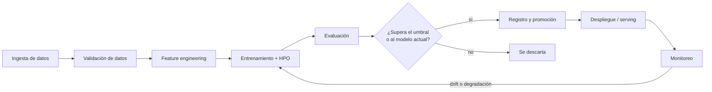

# Conceptos de MLOps

Teoría del flujo MLOps que implementan los dos proyectos del repositorio. Aquí están los conceptos **generales**, independientes de la herramienta; las herramientas y servicios concretos se explican en [`open-source/CONCEPTOS.md`](open-source/CONCEPTOS.md) y [`aws/CONCEPTOS.md`](aws/CONCEPTOS.md).

- [Conceptos de MLOps](#conceptos-de-mlops)
  - [1. Qué es MLOps](#1-qué-es-mlops)
  - [2. El ciclo de vida de un modelo](#2-el-ciclo-de-vida-de-un-modelo)
  - [3. Datos](#3-datos)
  - [4. Features](#4-features)
  - [5. Particularidades de las series de tiempo](#5-particularidades-de-las-series-de-tiempo)
  - [6. Entrenamiento y experimentación](#6-entrenamiento-y-experimentación)
  - [7. Evaluación y métricas](#7-evaluación-y-métricas)
  - [8. Registro, versionado y promoción](#8-registro-versionado-y-promoción)
  - [9. Orquestación y automatización](#9-orquestación-y-automatización)
  - [10. Serving](#10-serving)
  - [11. Despliegue de modelos](#11-despliegue-de-modelos)
  - [12. Monitoreo](#12-monitoreo)
  - [13. Reentrenamiento](#13-reentrenamiento)
  - [14. Reproducibilidad e infraestructura](#14-reproducibilidad-e-infraestructura)
  - [15. Niveles de madurez](#15-niveles-de-madurez)
  - [16. Dónde ver cada concepto en el repositorio](#16-dónde-ver-cada-concepto-en-el-repositorio)

---

## 1. Qué es MLOps

**MLOps** (Machine Learning Operations) es el conjunto de prácticas para llevar modelos de machine learning a producción y mantenerlos funcionando de forma confiable. Toma ideas de DevOps (automatización, versionado, integración y despliegue continuos, monitoreo) y les agrega lo que es propio del ML:

- **El sistema depende de datos, no solo de código.** Un modelo puede degradarse sin que nadie toque una línea de código, simplemente porque el mundo cambió.
- **El artefacto que se despliega es un modelo entrenado**, resultado de código + datos + hiperparámetros + semilla aleatoria. Reproducirlo exige versionar los cuatro.
- **La calidad no es binaria.** Un modelo no "compila o no compila": tiene un error esperado, y hay que decidir cuándo ese error es aceptable.

El objetivo es que entrenar, validar, desplegar y vigilar un modelo sea un proceso **repetible, automatizado y auditable**, no un notebook que alguien corre a mano.

## 2. El ciclo de vida de un modelo

Cada etapa produce algo que la siguiente consume (datos validados, features, un modelo, métricas, una versión aprobada) y cada una puede fallar y detener el flujo antes de que un problema llegue a producción. Esa idea de **gates** (compuertas) aparece en todo el repositorio.

## 3. Datos

- **Ingesta:** traer los datos desde su origen (un medidor, una API, una base de datos) a un lugar donde se puedan procesar. Puede ser **batch** (cargas periódicas) o **streaming** (evento a evento). Aquí es batch: cada ingesta es un snapshot completo del histórico.
- **Zonas de un data lake:** organizar los datos por nivel de procesamiento.
  - **Raw (cruda):** los datos tal como llegaron, sin tocar. Permite reprocesar si cambia la lógica.
  - **Curated (curada):** limpia, tipada, sin duplicados y con un esquema estable. Es la que consumen los modelos.
  - **Predictions / serving:** las salidas del modelo, para consultarlas y compararlas con la realidad.
- **Esquema descubierto vs. declarado:** el esquema raw se puede _descubrir_ automáticamente (un crawler lo infiere); el curado se _declara_ como código porque es un contrato del que dependen otros.
- **Contrato de datos:** acuerdo explícito de qué columnas, tipos y orden tiene un dataset o una petición al modelo. Cambiarlo rompe a los consumidores, así que se versiona y se cambia con cuidado.
- **Validación / calidad de datos:** reglas que los datos deben cumplir antes de usarse (sin nulos en columnas críticas, rangos válidos, sin duplicados, cantidad mínima de filas). Si una regla falla, el flujo se detiene: **es mejor no entrenar que entrenar con datos malos**.
- **Particionamiento:** guardar los datos separados por una clave (p. ej. la fecha de ingesta) para leer solo lo necesario y poder reprocesar una partición sin tocar las demás.
- **Formatos columnares (Parquet):** guardan los datos por columna, comprimidos y con tipos. Son mucho más eficientes que CSV para análisis.

## 4. Features

- **Feature:** variable de entrada del modelo (hora del día, temperatura, demanda de ayer a la misma hora…).
- **Feature engineering:** construir features útiles a partir de los datos crudos. En este proyecto:
  - **Calendario:** hora, día de la semana, mes, fin de semana y festivos.
  - **Lags:** el valor de la variable en un momento anterior (demanda de hace 24 h y de hace 168 h = una semana).
  - **Ventanas móviles:** estadísticas sobre un periodo anterior (media de las 168 horas previas).
  - **Encodings cíclicos:** representar variables circulares con seno y coseno, para que el modelo sepa que las 23 h están cerca de las 0 h y diciembre de enero.
  - **Interacciones:** combinaciones de features (temperatura × hora, ¿es hora pico?).
- **Training/serving skew:** diferencia entre cómo se calculan las features al entrenar y al servir. Es una de las causas más comunes de modelos que "funcionaban en el notebook" y fallan en producción. Se evita calculando las features **con el mismo código** en ambos lados; en el proyecto AWS, por ejemplo, el feature engineering va dentro del propio modelo serializado.
- **Feature store:** repositorio central de features reutilizables, con valores para entrenamiento (históricos) y para serving (en línea). Este repositorio no usa uno; las features se calculan en el pipeline.

## 5. Particularidades de las series de tiempo

- **Split temporal:** en series de tiempo los datos de entrenamiento, validación y test se separan **por fecha**, nunca al azar. Un split aleatorio dejaría al modelo "ver el futuro" y daría métricas irrealmente buenas.
- **Data leakage (fuga de información):** usar en el entrenamiento información que no estaría disponible al momento de predecir. Ejemplo típico: una media móvil que incluye la hora que se quiere predecir. Por eso la media de 7 días usa solo las horas **anteriores**.
- **Lags por tiempo, no por posición:** si falta una hora en los datos, "la fila de hace 24 posiciones" ya no es "la hora de hace 24 horas". Calcular los lags por timestamp evita corrimientos silenciosos.
- **Horizonte de pronóstico:** qué tan adelante se predice. Con lags de 24 h el modelo puede pronosticar como máximo un día adelante sin pronosticar también los lags.
- **Backtesting:** evaluar el modelo sobre un periodo pasado que no vio, simulando cómo habría funcionado. El scoring batch de AWS hace esto con los últimos días y lo compara con la demanda real.

## 6. Entrenamiento y experimentación

- **Hiperparámetros:** configuración del algoritmo que no se aprende de los datos (tasa de aprendizaje, número de árboles, número de hojas…).
- **HPO (Hyperparameter Optimization):** buscar automáticamente la mejor combinación de hiperparámetros. Puede ser búsqueda en grilla, aleatoria o **bayesiana** (usa los resultados anteriores para proponer combinaciones prometedoras). El **pruning** corta temprano los intentos que no van a ser buenos.
- **Early stopping:** detener el entrenamiento cuando el error en validación deja de mejorar, para no sobreajustar.
- **Gradient boosting:** familia de modelos (LightGBM, XGBoost) que entrena árboles de decisión en secuencia, cada uno corrigiendo los errores del anterior. Muy eficaz en datos tabulares.
- **Experiment tracking:** registrar cada ejecución de entrenamiento (**run**) con sus parámetros, métricas, artefactos y versión del código, para poder compararlas y reproducirlas. Responde a "¿con qué configuración salió este modelo?".
- **Artefacto:** cualquier archivo producido por una ejecución: el modelo serializado, gráficos, reportes, datasets intermedios.

## 7. Evaluación y métricas

Para regresión (pronosticar una cantidad), las métricas del repositorio son:

| Métrica | Qué mide                                                                                | Unidad |
| ------- | --------------------------------------------------------------------------------------- | ------ |
| MAE     | Error absoluto promedio                                                                 | kWh    |
| RMSE    | Raíz del error cuadrático medio; castiga más los errores grandes                        | kWh    |
| MAPE    | Error porcentual absoluto promedio; comparable entre series de distinta escala          | %      |
| R²      | Proporción de la varianza explicada por el modelo (1 = perfecto, 0 = predecir la media) | —      |

- **Validación vs. test:** el split de validación se usa _durante_ el entrenamiento (early stopping, HPO); el de test solo al final, para estimar el error real. Usar test para tomar decisiones de entrenamiento lo contamina.
- **Piso de error:** si los datos tienen ruido aleatorio, ningún modelo puede bajar de cierto error. En la serie sintética el ruido es de ±50 kWh sobre ~1 000 kWh, así que un MAPE cercano al 4 % ya está en el piso.
- **Quality gate:** umbral mínimo de calidad que un modelo debe cumplir para avanzar (p. ej. MAPE ≤ 5 %). Si no lo cumple, el pipeline falla de forma explícita.

## 8. Registro, versionado y promoción

- **Model registry:** catálogo central de modelos entrenados, con versiones numeradas, métricas, linaje (de qué datos y código salió cada uno) y estado.
- **Versión de modelo:** cada entrenamiento que se registra crea una versión nueva e inmutable. Nunca se sobrescribe un modelo.
- **Estados / etapas:** en qué punto del ciclo está una versión: pendiente de aprobación, aprobada, en producción, archivada, rechazada.
- **Champion / challenger:** el **champion** es el modelo que está en producción; el **challenger** es un candidato nuevo. El challenger solo reemplaza al champion si es mejor en una métrica acordada sobre los mismos datos de test.
- **Promoción automática vs. aprobación manual (human in the loop):** la promoción puede ser automática (si el challenger gana, pasa a producción) o requerir que una persona revise las métricas y apruebe. La aprobación manual agrega gobierno y control; la automática agrega velocidad. El proyecto open source usa la primera y el de AWS la segunda.
- **Contrato de despliegue:** separar _qué_ modelo está aprobado de _desplegarlo_. Aprobar publica la versión elegida en un lugar conocido; el despliegue la lee de ahí cuando alguien decide liberarla.

## 9. Orquestación y automatización

- **Pipeline:** secuencia de pasos (preparar datos, entrenar, evaluar, registrar) que se ejecuta como una unidad, con dependencias explícitas entre pasos.
- **DAG (Directed Acyclic Graph):** forma de describir un pipeline como un grafo de tareas con dependencias y sin ciclos. Permite paralelizar lo independiente y saber qué reintentar si algo falla.
- **Orquestador:** el sistema que ejecuta los pipelines, respeta el orden, reintenta, guarda el historial y los dispara según un calendario o un evento.
- **Disparadores (triggers):**
  - **Por calendario (schedule):** "cada lunes a las 6 a. m.".
  - **Por evento:** "cuando llegue un archivo nuevo", "cuando termine la curación", "cuando suene una alarma de drift".
  - **Manual:** una persona lo lanza.
- **Arquitectura orientada a eventos:** los componentes no se llaman directamente entre sí; publican eventos ("llegó un archivo", "se aprobó un modelo") y otros reaccionan. Desacopla las piezas y facilita agregar reacciones nuevas.
- **CI/CD/CT:**
  - **CI (integración continua):** cada cambio de código se prueba automáticamente (tests, lint, build).
  - **CD (entrega/despliegue continuo):** los cambios aprobados se despliegan de forma automatizada y repetible.
  - **CT (entrenamiento continuo):** el modelo se reentrena automáticamente cuando hay datos nuevos o cuando se degrada. Es la parte propia de MLOps.

## 10. Serving

- **Serving:** poner el modelo a disposición para que haga predicciones.
- **Inferencia online (tiempo real):** el modelo responde a cada petición en milisegundos, normalmente detrás de una API HTTP. Requiere infraestructura siempre encendida.
- **Inferencia batch:** el modelo procesa un lote grande de datos de una vez (p. ej. cada noche) y deja los resultados en un almacenamiento. Más barata: solo se paga mientras corre.
- **Endpoint:** la dirección de red donde vive un modelo desplegado y que acepta peticiones de predicción.
- **Serialización:** guardar el modelo entrenado en un archivo (pickle, joblib, formatos propios) para cargarlo después. El archivo solo es confiable con las **mismas versiones de librerías** con las que se guardó.
- **Throttling (limitación de tasa):** limitar cuántas peticiones por segundo acepta una API para protegerla de abuso o de costos inesperados.

## 11. Despliegue de modelos

- **Contenedor:** empaqueta el código, las librerías y el sistema operativo mínimo en una imagen. Garantiza que el modelo corra igual en la laptop, en el entrenamiento y en producción.
- **Imágenes inmutables:** una imagen con un tag (etiqueta) nunca cambia; una versión nueva lleva otro tag. Así cada modelo apunta a la imagen exacta que lo entrenó.
- **Estrategias de despliegue:**
  - **Blue/green:** se levanta la versión nueva (green) junto a la actual (blue), se pasa el tráfico y, si algo falla, se vuelve a la anterior.
  - **Canary:** se manda solo una fracción pequeña del tráfico a la versión nueva y se amplía de a poco.
  - **Shadow:** la versión nueva recibe una copia del tráfico, pero sus respuestas no se usan; sirve para compararla sin riesgo.
- **Rollback:** volver automáticamente (o con un comando) a la versión anterior cuando la nueva falla, por ejemplo cuando una alarma de errores se dispara durante el despliegue.

## 12. Monitoreo

Un modelo en producción se vigila en tres niveles:

1. **Operacional:** ¿está vivo y responde bien? Latencia, tasa de errores, uso de recursos.
2. **Datos:** ¿los datos que recibe se parecen a los de entrenamiento?
3. **Calidad del modelo:** ¿sigue acertando? Requiere conocer el valor real (**ground truth**), que muchas veces llega tarde.

Conceptos clave:

- **Data drift (drift de datos o covariate shift):** cambia la distribución de las entradas. Ejemplo: una ola de calor eleva todas las temperaturas por encima de lo visto en entrenamiento.
- **Concept drift:** cambia la _relación_ entre entradas y salida. Ejemplo: la misma temperatura ahora produce más demanda porque se instalaron más aires acondicionados. Solo se detecta midiendo el error contra la realidad.
- **Baseline / perfil de referencia:** la distribución de cada feature en los datos de entrenamiento, guardada junto al modelo. El monitoreo compara contra ella.
- **Data capture:** guardar una muestra de las peticiones y respuestas del endpoint para analizarlas después.
- **PSI (Population Stability Index):** métrica de cuánto cambió una distribución respecto a la referencia. Se agrupan los valores en bins y se calcula
  `PSI = Σ (actual% − esperado%) · ln(actual% / esperado%)`.
  Regla práctica: **< 0.1** sin cambio relevante, **0.1–0.2** cambio moderado, **> 0.2** cambio significativo.
- **Otras pruebas de drift:** Kolmogorov-Smirnov, Wasserstein, Jensen-Shannon, chi-cuadrado. Herramientas como Evidently eligen una según el tipo de columna y reportan la proporción de columnas con drift.
- **Alarmas y notificaciones:** cuando una métrica cruza un umbral, alguien (o algo) debe enterarse: un correo, un mensaje, o un disparador que inicie un reentrenamiento.

## 13. Reentrenamiento

- **Cuándo reentrenar:**
  - **Por calendario:** periódicamente, haya o no cambios. Simple, pero puede ser innecesario o llegar tarde.
  - **Por datos nuevos:** cada vez que llega un lote nuevo.
  - **Por drift o degradación:** cuando el monitoreo detecta un cambio. Más eficiente, pero depende de detectar bien.
- **Reentrenar no es desplegar:** el modelo reentrenado pasa por las mismas compuertas (quality gate, comparación con el champion, aprobación) antes de reemplazar al actual. Reentrenar con datos con drift no garantiza un modelo mejor.
- **Lazo cerrado:** monitoreo → disparador → pipeline → registro → despliegue. Cuando este lazo funciona sin intervención (salvo, quizá, la aprobación), se tiene entrenamiento continuo.

## 14. Reproducibilidad e infraestructura

- **Reproducibilidad:** poder regenerar un modelo idéntico. Requiere versionar código, datos (o la partición usada), hiperparámetros, semillas y el entorno (librerías con versión fija).
- **Linaje (lineage):** poder responder de qué datos, código, imagen y ejecución salió un modelo en producción.
- **Infraestructura como código (IaC):** describir la infraestructura (buckets, roles, servicios) en archivos versionados en lugar de crearla a mano en una consola. Se revisa, se versiona y se recrea igual en cada ambiente.
- **Ambientes / stages:** copias separadas del sistema (`dev`, `test`, `prod`) para probar sin afectar producción.
- **Principio de mínimo privilegio:** cada componente tiene solo los permisos que necesita (leer este bucket, invocar este endpoint), nada más.

## 15. Niveles de madurez

Una forma común de describir la madurez MLOps (popularizada por Google):

| Nivel | Descripción                                                                                                               |
| ----- | ------------------------------------------------------------------------------------------------------------------------- |
| 0     | Proceso manual: notebooks, entrenamiento y despliegue a mano, sin monitoreo.                                              |
| 1     | Pipeline de entrenamiento automatizado con entrenamiento continuo, validación de datos y de modelo, registro y monitoreo. |
| 2     | Además, CI/CD del propio pipeline: los cambios de código se prueban, construyen y despliegan automáticamente.             |

Los dos proyectos de este repositorio están en el **nivel 1** con piezas del nivel 2 (tests y CI, imágenes versionadas, infraestructura como código en AWS).

## 16. Dónde ver cada concepto en el repositorio

| Concepto                          | `open-source/`                                         | `aws/`                                                                |
| --------------------------------- | ------------------------------------------------------ | --------------------------------------------------------------------- |
| Zonas raw / curated / predictions | `data/raw`, `data/processed`                           | Prefijos `raw/`, `curated/`, `predictions/` del bucket data lake      |
| Validación de datos               | `src/data/validation.py` (Great Expectations)          | Ruleset de Glue Data Quality + `src/pipelines/training/preprocess.py` |
| Feature engineering               | `src/data/preprocessing.py`                            | `src/jobs/glue/curate_demand.py` + `src/features/engineering.py`      |
| Split temporal                    | `train_val_test_split` en `preprocessing.py`           | `split` en `src/pipelines/training/preprocess.py`                     |
| HPO                               | `src/models/hpo.py` (Optuna)                           | Parámetros del pipeline (`NEstimators`, `LearningRate`, `NumLeaves`)  |
| Experiment tracking               | MLflow Tracking                                        | SageMaker Experiments                                                 |
| Quality gate                      | Comparación con el champion (`src/models/evaluate.py`) | Paso `CheckMape` del pipeline                                         |
| Model registry                    | MLflow Model Registry (alias `@champion`)              | SageMaker Model Registry (aprobación manual)                          |
| Orquestación                      | DAGs de Airflow                                        | Glue workflow + EventBridge + SageMaker Pipelines                     |
| Serving online                    | API Flask / `mlflow models serve`                      | Endpoint de SageMaker + API Gateway + Lambda                          |
| Serving batch                     | —                                                      | Batch Transform                                                       |
| Drift                             | Evidently (DAG `mlops_monitoring`)                     | PSI en Python (`src/monitoring/drift.py`) + alarma de CloudWatch      |
| Reentrenamiento                   | DAG `mlops_retraining`                                 | Reglas de EventBridge (datos nuevos, calendario, drift)               |
| Despliegue blue/green y rollback  | —                                                      | `serverless/endpoint/sagemaker.yml`                                   |
| Infraestructura como código       | `docker-compose.yml`                                   | `serverless/` (Serverless Framework → CloudFormation)                 |
| CI                                | —                                                      | `.github/workflows/aws.yml`                                           |
