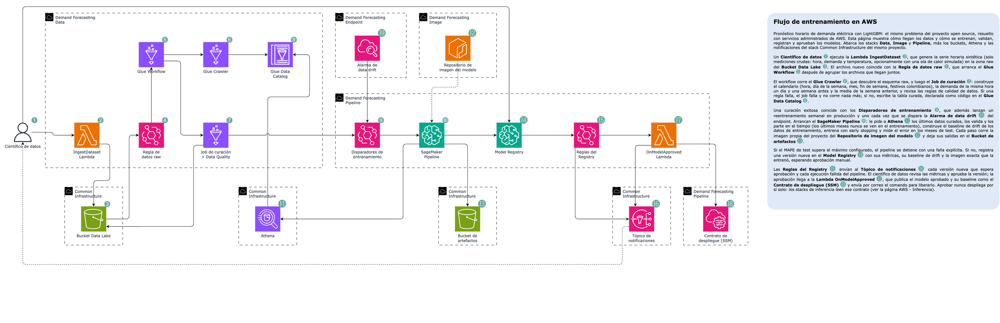
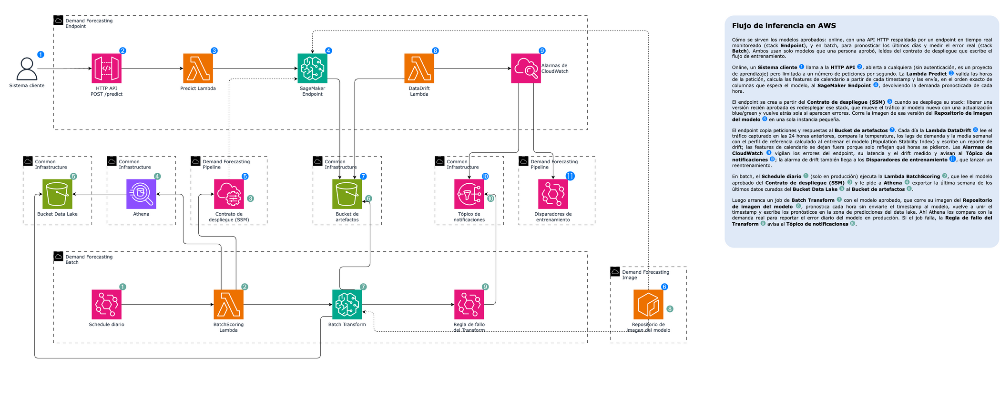

# MLOps Demand Forecasting en AWS

- [MLOps Demand Forecasting en AWS](#mlops-demand-forecasting-en-aws)
  - [Resumen](#resumen)
    - [Arquitectura](#arquitectura)
    - [Equivalencias con el proyecto open source](#equivalencias-con-el-proyecto-open-source)
  - [Setup](#setup)
    - [Contenedor de desarrollo](#contenedor-de-desarrollo)
    - [Variables de entorno](#variables-de-entorno)
    - [Suscripción a notificaciones](#suscripción-a-notificaciones)
    - [Despliegue](#despliegue)
    - [Actualizaciones](#actualizaciones)
    - [Aprobación de modelos](#aprobación-de-modelos)
    - [Operación](#operación)
    - [Desarrollo local](#desarrollo-local)
    - [Eliminar](#eliminar)
  - [Costos](#costos)
  - [Glosario](#glosario)
    - [Credenciales: `.envs/aws.env` y `.envs/sls.env`](#credenciales-envsawsenv-y-envsslsenv)
    - [Variables del proyecto: `.envs/config.env`](#variables-del-proyecto-envsconfigenv)
    - [Variables de despliegue de Serverless Framework](#variables-de-despliegue-de-serverless-framework)

---

## Resumen

Este es el mismo problema del proyecto [`open-source/`](../open-source/README.md) (pronóstico horario de demanda eléctrica con LightGBM, sobre la misma serie sintética), resuelto con **servicios administrados de AWS** en lugar de herramientas open source autoalojadas. Implementa el ciclo de vida completo del modelo: ingesta por eventos, catálogo y curación en Glue con Data Quality, Athena, un SageMaker Pipeline de entrenamiento, Model Registry con aprobación manual, un endpoint en tiempo real con monitoreo de drift, una API HTTP y scoring batch.

Todas las cargas de SageMaker (processing, training y serving) corren la imagen Docker propia del proyecto, publicada en ECR.

¿Algún servicio o término no te suena? [`CONCEPTOS.md`](CONCEPTOS.md) explica cada servicio de AWS que usa el proyecto, y el [`CONCEPTOS.md` de la raíz](../CONCEPTOS.md), la teoría general de MLOps.

Los recursos se crean como `Infrastructure as Code` y se despliegan con `Serverless Framework` v4. Sigue las convenciones del proyecto de referencia `mlops-customer-churn`, pero con la infraestructura base (buckets, Athena, SNS, Studio) en el mismo proyecto, como un stack más.

### Arquitectura

Diagramas en [`docs/architecture.drawio`](../docs/architecture.drawio) (páginas "AWS - Entrenamiento" y "AWS - Inferencia"; [`docs/architecture.html`](../docs/architecture.html) para verlo en el navegador). Cada paso numerado se explica en el cuadro de la derecha de cada página.





| Stack                 | Servicio                      | Qué crea                                                                                                                                                                                           |
| --------------------- | ----------------------------- | -------------------------------------------------------------------------------------------------------------------------------------------------------------------------------------------------- |
| `serverless/common`   | `common-infrastructure`       | Buckets de data lake (con EventBridge), artefactos y resultados de Athena; workgroup `mlops`; tópico SNS de notificaciones; parámetros SSM `/mlops-common-infrastructure/*`                        |
| `serverless/studio`   | `sagemaker-studio`            | _Opcional._ Dominio de SageMaker Studio con VPC mínima propia (2 subredes públicas, sin NAT) y un perfil para `DEVELOPER`                                                                          |
| `serverless/data`     | `demand-forecasting-data`     | Base Glue `demand_forecasting`, crawler raw, tablas `demand` (curada) y `predictions`, job de curación + ruleset de Data Quality, workflow, consultas de Athena, Lambda `IngestDataset`            |
| `serverless/image`    | `demand-forecasting-image`    | Repositorio ECR `mlops/demand-forecasting` (tags inmutables)                                                                                                                                       |
| `serverless/pipeline` | `demand-forecasting-pipeline` | Rol de SageMaker, Model Package Group, pipeline `demand-forecasting-training`, reglas de EventBridge (datos nuevos, schedule, drift, fallas, aprobaciones), Lambda `OnModelApproved`, contrato SSM |
| `serverless/endpoint` | `demand-forecasting-endpoint` | Model + EndpointConfig + Endpoint `demand-forecasting`, alarmas, Lambda `DataDrift`, Lambda `Predict` + HTTP API pública con throttling                                                            |
| `serverless/batch`    | `demand-forecasting-batch`    | Lambda `BatchScoring` (+ schedule) y regla de fallas del transform job                                                                                                                             |

### Equivalencias con el proyecto open source

| Etapa                    | `open-source/`                                | `aws/`                                                                                       |
| ------------------------ | --------------------------------------------- | -------------------------------------------------------------------------------------------- |
| Datos                    | `data/generate_dataset.py` → CSV local        | Lambda `IngestDataset` → zona raw de S3 (mismo generador, `src/datasets/`)                   |
| Feature engineering      | `src/data/preprocessing.py` (pandas)          | Glue job (Spark: calendario, lags, media móvil) + `src/features/engineering.py` en el modelo |
| Validación de datos      | Great Expectations                            | Glue Data Quality (DQDL) + gate en `PrepareData`                                             |
| Orquestación             | Airflow (`mlops_full_pipeline`)               | Glue workflow + EventBridge + SageMaker Pipelines                                            |
| Tracking de experimentos | MLflow Tracking                               | SageMaker Experiments (métricas de los training jobs)                                        |
| HPO                      | Optuna                                        | Hiperparámetros como parámetros del pipeline (AMT pendiente)                                 |
| Registro / promoción     | MLflow Registry, alias `@champion` automático | SageMaker Model Registry, quality gate por MAPE + aprobación manual                          |
| Serving                  | Flask / `mlflow models serve`                 | Endpoint de SageMaker (imagen propia) + API Gateway + Lambda                                 |
| Inferencia batch         | —                                             | Batch Transform → tabla `predictions` (MAPE en producción con Athena)                        |
| Monitoreo de drift       | Evidently (DAG `mlops_monitoring`)            | Data capture + Lambda PSI + alarma de CloudWatch                                             |
| Reentrenamiento          | DAG `mlops_retraining`                        | Reglas de EventBridge: datos nuevos, schedule, alarma de drift                               |

El modelo es el mismo: LightGBM con los mismos 17 features y los mismos hiperparámetros por defecto. Con el dataset por defecto (2022-2024) el split temporal coincide con el del proyecto open source (train 2022-2023, validación 2024-S1, test 2024-S2) y el MAPE de test ronda el 4 %.

---

## Setup

### Contenedor de desarrollo

Estos pasos están pensados para Visual Studio Code; puedes usar otro IDE haciendo los ajustes necesarios.

1. Instala la extensión `ms-vscode-remote.remote-containers`.
2. Asegúrate de que Docker esté corriendo: el contenedor usa el daemon del host para construir la imagen del modelo.
3. Abre esta carpeta (`aws/`) en VS Code y acepta reabrirla en el contenedor (`MlopsDemandForecasting`).

El contenedor (`.docker/Dockerfile`) trae Node 24, Python 3.13, AWS CLI v2, Serverless Framework v4, `cfn-lint`, Docker CLI, pytest y linters, más `container/requirements.txt`: el mismo runtime fijo de la imagen del modelo en SageMaker. Monta la raíz del monorepo en `/app`.

### Variables de entorno

En `.envs/` crea `aws.env`, `sls.env` y `config.env` a partir de los `*.example` (ver [Glosario](#glosario)). Solo los `*.example` se versionan.

### Suscripción a notificaciones

Cada correo de `NOTIFICATION_EMAILS` recibe un mensaje `AWS Notification - Subscription Confirmation` tras el primer despliegue de `serverless/common`. Hay que hacer clic en el enlace; si no, no llega ninguna notificación.

### Despliegue

Con [Serverless Framework](https://www.serverless.com/framework/docs/providers/aws/cli-reference/deploy/). El orden es el mismo en `dev`, `test` y `prod`; reemplaza `<stage>` en cada comando (p. ej. `npm run deploy-data:test`). Las credenciales de `.envs/aws.env` deben ser de la cuenta de ese stage.

1. Despliega `serverless/common`: `npm run deploy-common:<stage>` y confirma la [suscripción a notificaciones](#suscripción-a-notificaciones)
2. _(Opcional)_ Despliega `serverless/studio`: `npm run deploy-studio:<stage>`. Para abrirlo: consola de AWS → `SageMaker AI` → `Domains` → `mlops` → tu perfil → `Launch` → `Studio`
3. Despliega `serverless/data`: `npm run deploy-data:<stage>`
4. Despliega `serverless/image`: `npm run deploy-image:<stage>`
5. Construye y publica la imagen del modelo en ECR: `npm run image:push`. Docker debe estar corriendo; si el tag ya existe no se construye nada
6. Despliega `serverless/pipeline`: `npm run deploy-pipeline:<stage>`. Falla si la imagen del paso 5 no está en ECR
7. Carga los datos en el data lake: `npm run ingest`. Esto arranca la curación y, si sale bien, un entrenamiento
8. Espera a que el pipeline termine: `npm run pipeline:executions`. Al terminar llega un correo con la versión pendiente de aprobación
9. Aprueba la versión (ver [Aprobación de modelos](#aprobación-de-modelos))
10. Despliega `serverless/endpoint`: `npm run deploy-endpoint:<stage>`
11. Despliega `serverless/batch`: `npm run deploy-batch:<stage>`

> No ejecutes `npm run pipeline:start` justo después de `npm run ingest`: la partición curada solo existe cuando termina el job de Glue (varios minutos), y ese éxito ya arranca el pipeline. Si lo arrancas antes, `PrepareData` falla porque la consulta de Athena no devuelve filas.

### Actualizaciones

| Cambio                                                                                                            | Pasos                                                                                                                          |
| ----------------------------------------------------------------------------------------------------------------- | ------------------------------------------------------------------------------------------------------------------------------ |
| Código del modelo (`src/features`, `src/models`, `src/monitoring`, `src/pipelines`, `src/serving`) o `container/` | Paso 5 (`npm run image:push`) y luego paso 6 (`npm run deploy-pipeline:<stage>`). El próximo entrenamiento usa la imagen nueva |
| Se aprobó una versión nueva del modelo                                                                            | Paso 10 (`npm run deploy-endpoint:<stage>`) la publica en el endpoint. El batch la usa en su próxima ejecución                 |
| Job de Glue (`src/jobs/glue`) o configuración del stack de datos                                                  | Paso 3 (`npm run deploy-data:<stage>`)                                                                                         |
| Lambdas o configuración de un stack                                                                               | Desplegar solo ese stack                                                                                                       |

### Aprobación de modelos

Todo modelo con MAPE de test ≤ `MAX_MAPE` se registra en el grupo `demand-forecasting` como `PendingManualApproval` y se envía un correo al tópico de notificaciones.

```bash
npm run models                                   # versiones, estado, MAPE y RMSE de test
npm run models -- --approve <version>            # aprobar
npm run models -- --reject <version> --description "<motivo>"
```

También se puede aprobar desde SageMaker Studio → `Models` → `demand-forecasting`. Aprobar no despliega: publica el contrato en SSM y avisa con el comando de deploy.

### Operación

| Tarea                                                               | Comando                                                             |
| ------------------------------------------------------------------- | ------------------------------------------------------------------- |
| Cargar los datos en el data lake (arranca curación y entrenamiento) | `npm run ingest`                                                    |
| Cargar los datos con drift simulado (ola de calor)                  | `npm run ingest:drift`                                              |
| Arrancar un entrenamiento manual                                    | `npm run pipeline:start`                                            |
| Ver las últimas ejecuciones del pipeline                            | `npm run pipeline:executions`                                       |
| Ejecutar el batch scoring ahora                                     | `npm run batch:run`                                                 |
| Enviar tráfico a la API de predicción                               | `python3 -m src.scripts.generate_traffic --api-url <url> [--drift]` |

`IngestDataset` acepta un evento opcional para extender el histórico, p. ej. `sls invoke -f IngestDataset --data '{"end_date": "2025-06-30"}'` desde `serverless/data`.

La URL de la API está en el parámetro SSM `/mlops-demand-forecasting-endpoint/PredictUrl`. No tiene autenticación y acepta hasta 10 peticiones por segundo (ráfagas de 20); las de más reciben `429 Too Many Requests`. Las features de calendario se calculan a partir del `timestamp`:

```bash
URL=$(aws ssm get-parameter --name /mlops-demand-forecasting-endpoint/PredictUrl --query Parameter.Value --output text)
curl -s -X POST "$URL" -H 'Content-Type: application/json' -d '{
  "records": [{
    "timestamp": "2024-07-01 18:00",
    "temperature_c": 29.4,
    "demand_lag_24h": 1180.2,
    "demand_lag_168h": 1150.7,
    "demand_rolling_mean_7d": 1012.3
  }]
}'
# {"predictions": [{"demand_kwh": 1187.4, "timestamp": "2024-07-01 18:00:00"}]}
```

Consultas guardadas en Athena (workgroup `mlops`): perfil de demanda por hora, frescura de los datos, filas raw vs curated y **precisión del batch (MAPE por día)**, que cruza el último pronóstico batch con la demanda real.

### Desarrollo local

```bash
npm run local:generate      # genera la serie sintética en data/local/
npm run local:train         # cura, valida, entrena y evalúa en local, sin AWS
npm run image:build-local   # construye la imagen del modelo
npm test
npm run format
npm run lint
```

### Eliminar

Usa el comando `remove` de [Serverless Framework](https://www.serverless.com/framework/docs/providers/aws/cli-reference/remove/) en orden inverso al despliegue. Si falla, revisa la causa en la consola de AWS, corrígela y vuelve a intentar.

El stack `serverless/endpoint` cuesta por hora mientras existe: elimínalo cuando no lo uses (`cd serverless/endpoint && sls remove --stage <stage>`).

El repositorio ECR se conserva al eliminar `serverless/image` (los modelos registrados dependen de sus imágenes); bórralo a mano si ya no lo necesitas.

`serverless/common` va al final, y sus buckets deben estar vacíos para poder eliminarlos. Al eliminar `serverless/studio`, SageMaker puede dejar recursos creados fuera de CloudFormation (el EFS con el home de los usuarios, sus mount targets y security groups); bórralos desde la consola si el stack no logra eliminar la VPC.

---

## Costos

Aproximados en `us-east-1` (verifica los precios vigentes):

| Recurso                                       | Se cobra                      | Orden de magnitud          |
| --------------------------------------------- | ----------------------------- | -------------------------- |
| Endpoint `ml.t2.medium`                       | 24/7 mientras exista el stack | ~USD 0.056/h (~USD 41/mes) |
| Ejecución del pipeline (4 jobs `ml.m5.large`) | por ejecución                 | < USD 0.10                 |
| Job de Glue (2 × G.1X, mínimo 1 min)          | por ejecución                 | ~USD 0.05                  |
| Batch Transform                               | por ejecución                 | < USD 0.05                 |
| Lambdas, Athena, ECR, S3                      | uso                           | centavos al mes            |

| Configuración por stage                      | dev     | test    | prod   |
| -------------------------------------------- | ------- | ------- | ------ |
| Reentrenamiento programado (lunes 06:00 UTC) | apagado | apagado | activo |
| Batch scoring programado (diario 07:00 UTC)  | apagado | apagado | activo |
| Data capture del endpoint                    | 100 %   | 100 %   | 20 %   |
| Reentrenamiento por alarma de drift          | activo  | activo  | activo |
| Retención de logs de Lambda                  | 1 día   | 3 días  | 7 días |

---

## Glosario

### Credenciales: `.envs/aws.env` y `.envs/sls.env`

- `AWS_ACCESS_KEY_ID` / `AWS_SECRET_ACCESS_KEY`: credenciales con permisos suficientes para desplegar los stacks
- `AWS_DEFAULT_REGION`: región de despliegue. Los stacks solo permiten `us-east-1`
- `AWS_DEFAULT_OUTPUT`: formato de salida del AWS CLI (`json`)
- `SERVERLESS_ACCESS_KEY`: _API key_ de Serverless Framework v4
- `ORG`: nombre corto de la organización (minúsculas, sin espacios). Prefijo de todos los buckets: debe hacerlos únicos a nivel global. P. ej. `miorg`

### Variables del proyecto: `.envs/config.env`

- `DEVELOPER`: tu usuario (correo sin dominio). Garantiza nombres únicos de buckets en `dev` y es el perfil de Studio
- `NOTIFICATION_EMAILS`: correos separados por comas suscritos al tópico de notificaciones (fallas del pipeline, modelos pendientes de aprobación, modelos aprobados, alarmas del endpoint y de drift). P. ej. `alice@example.com,bob@example.com`
- `MAX_MAPE` _(opcional)_: MAPE de test (%) máximo para registrar un modelo. Por defecto `5.0`
- `SKIP_IMAGE_CHECK` _(opcional)_: `true` omite la verificación de que la imagen exista en ECR al resolver `serverless/pipeline` (p. ej. para `serverless print` antes de publicar la imagen). Por defecto `false`

### Variables de despliegue de Serverless Framework

- `stage`: etapa de despliegue: `dev`, `test` o `prod` (una cuenta de AWS por stage)
- Otras opciones se pasan por CLI: [referencia de `deploy`](https://www.serverless.com/framework/docs/providers/aws/cli-reference/deploy/)

Convenciones de todos los stacks: `stackName: mlops-<servicio>`; los valores entre stacks viajan por parámetros SSM `/mlops-<servicio>/<Nombre>`, nunca por exports de CloudFormation; safeguards de versión del framework, solo `us-east-1`, stages `dev|test|prod` y nombres de función `<servicePrefix>-<Función>`.
